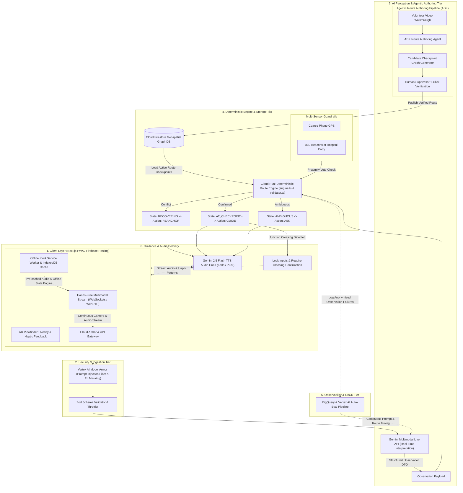

# RFC: Continuous Multimodal Streaming, Agentic Route Authoring, and Firestore Geospatial Graph Storage

**Status**: Proposed  
**RFC Document**: [docs/architecture/rfc-system-scale-enhancements.md](docs/architecture/rfc-system-scale-enhancements.md)  
**Mermaid Diagram**: [docs/architecture/rfc-system-scale-enhancements.mmd](docs/architecture/rfc-system-scale-enhancements.mmd)  

---

## 📌 PR Title
`rfc(architecture): Proposal for Continuous Multimodal Streaming, Agentic Route Authoring, and Firestore Geospatial Graph Storage`

---

## 📝 Description & Executive Summary

This Pull Request (RFC) presents a comprehensive architectural proposal and system design enhancement for **Nightingale**. Based on a detailed analysis of the current production codebase (`Nightingale` PWA frontend and `Nightingale-Walk-with-Me` backend), this RFC outlines a phased roadmap to transition Nightingale from a single-route hackathon prototype into a multi-route, enterprise-grade, global accessibility platform.

The proposal adheres strictly to Nightingale’s foundational principle:
> **"AI interprets; a field-verified route decides."**

---

## 🔍 Background & Current State Limitations

An analysis of the current implementation highlights several structural bottlenecks that constrain usability, scalability, and trust:

1. **Static JSON Route Storage**:
   * *Current State*: Ground-truth checkpoints reside in static JSON files (`fixtures/*.json`) with closed-set vocabularies (`routeVocabulary`).
   * *Limitation*: Adding or updating routes requires developer intervention, manual JSON editing, and redeploying backend container code to Cloud Run.
2. **Single-Route Limitation**:
   * *Current State*: Route coverage is limited to a single 300m walk (MRT Zhongxiao Fuxing Exit 2 to Taipei City Hospital Renai Branch).
   * *Limitation*: Lack of volunteer/family authoring tools prevents scaling across hospital hubs globally.
3. **Discrete HTTP Observation Round-Trips**:
   * *Current State*: Every photo or voice observation triggers a discrete HTTP POST request (`/api/sessions/:id/observations`).
   * *Limitation*: High latency and potential drops in cellular dead zones near dense concrete hospital entrances disrupt step guidance.
4. **Hardcoded Session Throttling**:
   * *Current State*: Hard sliding-window limits (`src/limits.ts`) cap uploads per walk session.
   * *Limitation*: Disoriented walkers uploading multiple photos in rapid succession risk encountering HTTP `429 Too Many Requests`.

---

## 🚀 Proposed Architectural Enhancements (RFC)

### 1. Usability: Hands-Free Multimodal Streaming & Offline PWA
* **Gemini Multimodal Live API via WebSockets/WebRTC**:
  * Replace discrete HTTP POST requests with a continuous streaming channel on Cloud Run.
  * Enables ambient audio guidance where walkers receive real-time, hands-free directional cues as visual landmarks pass their camera view.
* **Offline-First PWA Caching**:
  * Utilize PWA Service Workers and `IndexedDB` to pre-cache route graphs, state machine rules, and pre-rendered **Gemini 2.5 Flash TTS** audio files (`Leda`/`Puck` voices).
  * Guarantees uninterrupted step-by-step guidance even if cellular connectivity drops during the 300m walk.

### 2. Scalability: Cloud Firestore Graph DB & Agentic Route Authoring
* **Cloud Firestore Geospatial Graph Storage**:
  * Migrate static JSON fixtures to Cloud Firestore. Model routes as geospatial graphs (`Nodes = Checkpoints/Signs`, `Edges = Step-Free Walkways`).
* **Agentic Crowdsourcing Pipeline (Agent Development Kit - ADK)**:
  * Deploy an automated **Route Authoring Agent** using Google's ADK and Vertex AI Agent Engine.
  * Volunteers or family members record a video walk of a new route; the agent extracts signage, identifies ramps/elevators, and drafts candidate graph nodes in Firestore for 1-click human verification.

### 3. Trust & Security: Enterprise Guardrails & Multi-Sensor Veto
* **Vertex AI Model Armor Integration**:
  * Position Model Armor upstream of Gemini processing to filter out prompt injection attempts (e.g., physical stickers/posters placed on signs) and automatically redact faces and license plates.
* **Multi-Sensor Veto Guardrails**:
  * Augment phone GPS with low-cost **Bluetooth LE (BLE) Beacons** at hospital entrances to provide multi-sensor physical proximity verification before establishing arrival.

---

## 📊 System Flow Diagram (Mermaid)

---

## 🌎 Global Impact & Real-World Use Cases

* **Navigating Large Indian & Regional Medical Campuses**:
  * Solves multi-gate navigation at large public hospitals (e.g., AIIMS Delhi, NIMHANS Bengaluru, Siriraj Bangkok) where standard GPS marks arrival at perimeter walls 300+ meters away from step-free OPD doors.
* **Overcoming Local Script & Literacy Barriers**:
  * Translates street signage in real-time across regional scripts (Hindi, Tamil, Thai, Marathi) while displaying spoken **"Help Me Ask" cards** to assist disoriented travelers.

---

## 🧪 Implementation & Migration Plan

1. **Phase 1 (Backend Database Migration)**:
   * Implement Firestore schema for route graphs and update `validator.ts` to load nodes dynamically.
2. **Phase 2 (Security & Model Armor)**:
   * Deploy Vertex AI Model Armor upstream of Gemini observation requests.
3. **Phase 3 (Agentic Authoring Tooling)**:
   * Build the ADK-powered volunteer video ingestion tool for automated candidate route generation.
4. **Phase 4 (Continuous WebSockets & Offline PWA)**:
   * Roll out WebSocket streaming endpoints on Cloud Run and Service Worker caching on the PWA.

---
*Submitted for community review and architectural feedback.*
